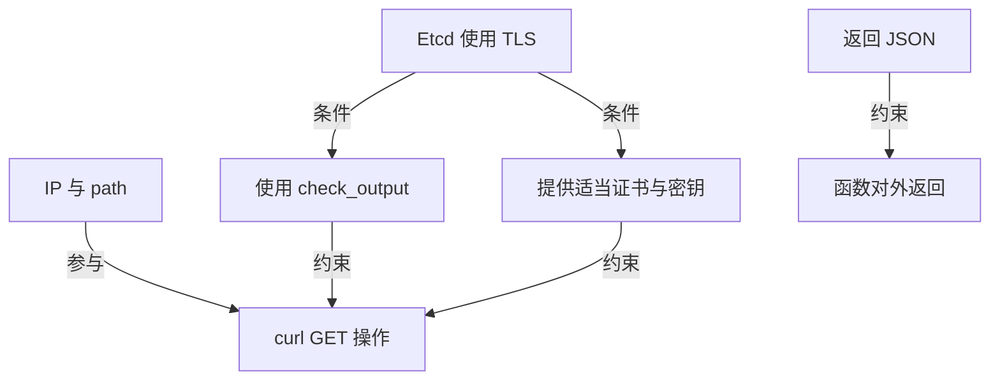

# 人工参考图与下游诊断

对上一轮固定的 **12 道已暴露自然任务**，由 Codex 直接阅读完整原文、编写语义
记录，通过现有 `source_records.compile_records` 构图，再测试绑定、编辑、
Discovery 折分及基线测量。没有调用外部 API，没有修改主线算法或论文。

这是**作者构建的参考图**，不是独立人工金标准，不计入自动抽取准确率。
原文中的歧义保留；“正确图”不意味着为未说明的关系挑选一种方便研究的解释。
本轮测试既有三个政策在这些图上的使用，没有运行新的候选发现模型。

## 结果

| 下游检查 | 实际结果 |
| --- | --- |
| 原始图编译 | 12/12，通过现有编译器 |
| 可用于当前 ADD 的完整作用范围 | 10/12；另外 2 个比较范围未确定 |
| 四臂提示渲染 | 10 × 4 = 40 个提示，原始任务与系统消息原样保留 |
| 编辑后参考图 | 10/10 从未表达变为明确表达；这是人工构造的编辑对照，不能算自然正例 |
| 真实 Discovery 折分检查 | 三个因素均返回 `Atomic candidate lacks state support for every frozen fold` |
| 既有基线回复的当前测量回放 | 全部 12 条保留；11 条代码有效、1 条语法无效 |
| 基线安全状态 | 7 secure、3 insecure、1 unknown、1 因语法无效未运行 |
| 基线功能状态 | 6 pass、5 fail、1 因语法无效未运行 |

基线取自此前 Qwen2.5-Coder-7B 运行的固定首个种子 `2026091201`，功能回复来自
当时的 Qwen2.5-Coder-32B。回放核对完整请求，重新执行本地安全测量和结果组装；
11 个有效程序的功能请求均与保存请求一致。没有重新生成代码，也没有重算或
声称新的干预效果。两道作用范围不确定的任务仍保留在这 12 条基线回放中。

四臂渲染和人工编辑对照验证的是结构与接口衔接，不证明模型会遵守编辑，
也不替代独立干预语义审核。没有把新图用于改判任何旧实验结果。

## 每道任务的图

`annotations.json` 是可直接阅读和修改的原文语义判断；`inputs/tasks.json`
保留原始输入。每个 `results/case-NN/` 包含原始 `graph.json`、`records.json`、
`contract.json`、结构读法及诊断结果。可编辑题另有四臂提示与
`edited-reference.json`，后者明确标记为非自然样本、非模型抽取。

| 编号 | 任务 | 关键绑定或保留内容 | 当前政策 |
| --- | --- | --- | --- |
| 01 | PDF 上传 | 文件保存、MySQL 存 filepath、之后下载；只给 filepath 加参数绑定 | 可渲染 |
| 02 | 温度查询 | 六个查询值均保留；本政策只改变 latitude 的绑定要求 | 可渲染 |
| 03 | 密码查询比较 | userid 用于查询；提供的 password 用于随后比较；不推断 base64 必须使用 | 可渲染 |
| 04 | usermod | username/password 为命令输入；逗号连接返回值只约束函数 | 可渲染 |
| 05 | ping 存活判断 | 零状态→alive，非零→not alive；分支约束判断，不约束 ping 的执行 | 可渲染 |
| 06 | Etcd curl | TLS 条件分别约束 check_output 和证书要求；JSON 返回只约束函数 | 可渲染 |
| 07 | 日期与文件读取 | days 是日期计算输入；不保证它是 date 命令参数 | 范围未确定 |
| 08 | ping 输出 | URL 进入 ping；输出返回要求约束函数 | 可渲染 |
| 09 | SSH 密钥 | root 是函数资源；不保证它直接成为 ssh-keygen 参数；保留三类密钥和错误日志 | 范围未确定 |
| 10 | bsub | 输入参数列表、subprocess、解析 job ID/exit code、日志 | 可渲染 |
| 11 | rpm | 包列表、逐包 changelog、列表追加；不推断整个列表是一个 argv 元素 | 可渲染 |
| 12 | 图片读取 | name 与 images/name 的文件打开、/img 路由、文件响应 | 可渲染 |

旧图明确把 07 的 days 和 09 的 root 都连成 `object.command_argument → used_by →
process_execute`。这两条关系并非原文必然含义。新图保留对象及有依据的用途，
撤去这些过强绑定。程序仍可建立位置绑定，但尝试 ADD 时因精确范围状态为
unresolved 而拒绝。这是删除不充分依据带来的正确阻断，不能算成抽取退化。

例如 06 的关键结构为：



## 对推进路线的判断

人工图已经让我们绕过自动抽取，验证了 10 道题的编辑衔接。**此批任务的
Discovery 阻碍仍然是样本状态支持**：SQL 为 3 个自然 0；命令为 6 个自然 0、
2 个比较范围未知；路径为 1 个自然 0；三个因素都没有自然 1。
相关要求未在原文表达，与能否确定其具体干预范围是两项不同判断。

现在可以用这些图作为固定诊断输入，直接推进后续程序。要测试自然数据上的
FCI，仍应在固定自然开发总体中检查支持，不能把这 10 个编辑后图充入自然样本。
要测试生成模型的干预反应，则可在这 10 道可编辑题上另做小规模四臂开发实验，
其结果属于给定政策的开发比较，不冒充 Discovery 选择的收益。

## 复现

在仓库安装现有依赖后：

```text
python data/method/manual-graph-downstream-v1/replay.py NEW_OUTPUT_DIRECTORY
```

调用的都是现有编译、绑定、渲染、折分、测量与结果组装函数。输入、基线回复
和结果使用现有精确字节 manifest。重复执行应产生相同 JSON；全程离线。
干净源码导出的运行与开发运行共 120 个结果 JSON 文件完全一致，验证记录位于
`validation/report.json`。未改变生产代码，复用上一轮通过的现有测试结果。
本轮只增加这个有固定任务边界的诊断，不增加默认测试或另一条活跃研究流程。
